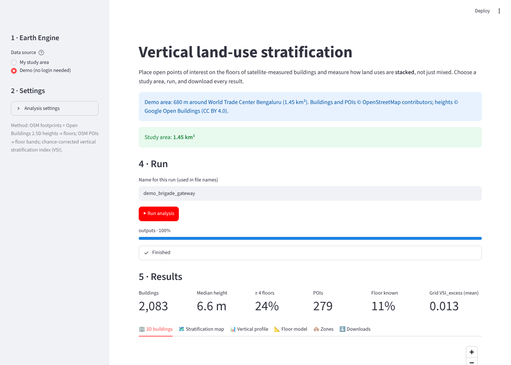

# Vertical land-use stratification (2.5D)

**Measure how urban activities are stacked inside buildings — for any study area, using only open data.**

Points of interest (POIs) record activities as flat coordinates, so ten shops in one tower look the same as ten shops along a street. This toolkit places open POIs on the floors of satellite-measured buildings and computes a **chance-corrected vertical stratification index (VSI)**: the share of an area's land-use mix that is explained by floor.

You choose a study area — **draw it on a map or upload a KML** — and the pipeline does the rest:

1. **Buildings:** OpenStreetMap footprints are downloaded for the area.
2. **Heights → floors:** the median and 90th-percentile height of each footprint come from Google's *Open Buildings 2.5D Temporal* dataset (Earth Engine). A height-to-floor model is calibrated and cross-validated on the area's own OSM `building:levels` tags.
3. **POIs → floors:** OSM POIs are classified into 11 land uses and linked to buildings. Floors are read from `level`/`addr:floor` tags and from address text (e.g. "3rd Floor", GF, LGF). The remaining floors are predicted by a gradient-boosted classifier.
4. **Vertical indices:** floor uncertainty is propagated through Monte Carlo draws. Entropies, mutual information and VSI are computed for buildings, grid cells and (optionally) your own zones, with a permutation null that removes small-sample bias.
5. **Optional change analysis:** new, taller and lower buildings between 2016–17 and 2022–23.



---

## Quick start: the portal

```bash
git clone https://github.com/ravi-rayv/vertical-landuse-stratification.git
cd vertical-landuse-stratification
pip install -e ".[app]"
streamlit run app/streamlit_app.py
```

The portal opens in your browser:

1. **Try the demo first.** Choose *Demo (no login needed)* and click **Run analysis**. It uses stored data for 680 m around World Trade Center Bengaluru and needs no internet or Earth Engine account.
2. **For your own area:**
   - Enter your Earth Engine project ID (see below).
   - Draw a polygon or rectangle on the map, or upload a `.kml`, `.kmz`, `.geojson` or zipped shapefile.
   - Optionally upload zones (e.g. wards, with a population column) for zone-level statistics and correlations.
   - Click **Run analysis**, look through the results tabs, and download everything as one zip.

## Earth Engine access (each user brings their own)

Building heights come from Google Earth Engine. Each user signs in with **their own** project, so nobody else's quota or credentials are used.

1. Register a Cloud project for Earth Engine (free for non-commercial and research use): <https://code.earthengine.google.com/register>.
2. **Running on your own computer:** run `earthengine authenticate` once, then enter the project ID in the portal.
3. **Using a hosted copy of the portal:** upload your own service-account key (JSON) in the sidebar. It is used in memory for that session only and is never stored. See [docs/earth_engine.md](docs/earth_engine.md).

## Command line and Python

```bash
# full run for a KML study area
vertical25d run --aoi my_area.kml --ee-project my-ee-project

# with wards, population, change analysis and custom settings
vertical25d run --aoi city.zip --zones wards.zip --zone-name ward_name --zone-pop population \
                --ee-project my-ee-project --change --set grid_m=300 --set n_sim=100

vertical25d settings          # list every setting and its default
vertical25d demo              # offline demo, no login needed
```

```python
from vertical25d import Settings, Inputs, read_aoi, run

aoi = read_aoi("my_area.kml")
res = run(Inputs(aoi=aoi, ee_project="my-ee-project", name="my_area"), Settings(grid_m=300))
res.summary["indices"]          # headline numbers
res.grid                        # GeoDataFrame of grid cells with VSI_excess
```

The notebook [notebooks/quickstart.ipynb](notebooks/quickstart.ipynb) does the same and runs in Google Colab.

## Outputs

Every run writes one folder (also zipped):

| File | Content |
|---|---|
| `buildings_floors.csv / .gpkg` | Each building's height (`h_median`, `h_p90`), estimated floors, final floors (`floors_final`), floor source (OSM tag / estimated / none) and quality flags |
| `poi_buildings.csv / .gpkg` | POIs with land use, parsed floor, linked building and match type (inside / nearest / none) |
| `poi_band_probabilities.csv` | Floor-band probabilities used in the Monte Carlo draws |
| `vertical_profile.csv` | Share of each land use on each floor band |
| `vertical_index_buildings.csv` | H_use, H_band, MI, VSI, VSI_null, VSI_excess, VSI_conf per building (≥ 3 POIs) |
| `vertical_index_grid.csv / .gpkg` | The same indices per grid cell (≥ 10 POIs) |
| `vertical_index_zones.csv / .gpkg` | If zones were given: indices, built form, FAR, POI and population density per zone |
| `zone_correlations_spearman.csv` | If zones were given: Spearman correlations |
| `building_change.csv` | If change analysis was run: new / taller / lower / stable per building |
| `summary.json` | All settings and headline numbers of the run |
| `figures/` | PNG and SVG figures |

**Reading the indices.**
- **H_use** and **H_band** are entropies, normalised by ln K and ln B.
- **VSI = MI / H_use**. It is 0 when uses mix the same way on every floor and 1 when each floor holds a single use.
- **VSI_excess = VSI − VSI_null**: stratification beyond what random floor assignment would give. This is the index to interpret.
- **VSI_conf**: the share of Monte Carlo draws in which VSI exceeds the null.

## Settings

All defaults reproduce the Bengaluru study. The main ones:

| Setting | Default | Meaning |
|---|---|---|
| `year` | 2023 | Open Buildings layer used for heights |
| `floor_model` | `linear` | `linear` (Huber), `isotonic`, `formula` or `auto` (lowest cross-validated error) |
| `keep_higher_osm_tags` | `False` | Keep OSM floor tags that are higher than the satellite estimate; see the limitations |
| `match_dist_m` | 20 | Snap distance from a POI to the nearest building |
| `n_sim` | 200 | Monte Carlo draws |
| `min_poi_building` / `min_poi_area` | 3 / 10 | Minimum POIs for a building / grid cell or zone to get an index |
| `grid_m` | 500 | Grid cell size (m) |
| `run_change` | `False` | Change analysis 2016–17 → 2022–23 |
| `max_area_km2` | 1500 | Safety limit; large areas are downloaded in parts |

## How long does it take?

The portal handles a neighbourhood of a few km² in a few minutes. A whole city of ~700 km² and ~700,000 buildings takes 30–90 minutes. Most of that time goes to the OSM download and about 350 Earth Engine batches. For large areas, prefer the command line on a local machine.

### Large areas

Large study areas are downloaded in parts, the parts are combined, and only then is the analysis run:

- **OpenStreetMap:** the area is cut into tiles of about 9 km². A tile that is too big for the servers is split into four.
- **Earth Engine:** buildings are sent in batches of 1,500 neighbouring buildings, so each request covers a small patch of the city. A batch that fails is split in half and retried, instead of its buildings silently getting no height.
- **Resume:** every finished tile and batch is saved on disk (in your temporary folder). If a run stops halfway, running it again with the same area skips everything already done.
- **Memory:** a whole city needs several GB of RAM. The free Streamlit Community Cloud gives about 1 GB, so run large areas on your own computer (`streamlit run streamlit_app.py` or the `vertical25d` command).

OpenStreetMap data come from the public Overpass servers. Large areas are downloaded in parts, with progress shown as they arrive. A server that does not answer is skipped after 10 seconds, and a busy one after one short wait. Downloaded parts are cached, so a re-run after an interruption skips them. If the public servers are slow where you are, set the environment variable `VERTICAL25D_OVERPASS_URL` to another Overpass server (e.g. `https://overpass.private.coffee/api`) to try it first.

## Deploying the portal

- **Streamlit Community Cloud:** fork this repo, then create a new app pointing to `app/streamlit_app.py`. `requirements.txt` installs everything. Users sign in with their own service-account key.
- **Hugging Face Spaces / any server:** use the included `Dockerfile`: `docker build -t vertical25d . && docker run -p 8501:8501 vertical25d`.
- **Local:** `streamlit run app/streamlit_app.py`.

## Method and validation

The method is described in [docs/methodology.md](docs/methodology.md). The package reproduces the Bengaluru results of the accompanying paper:
- **Floor model:** floors = 0.67 + 0.301·h, with 11,216 plausible and 498 excluded tags.
- **Cross-validation:** MAE 1.09 and 76% of buildings within ±1 floor.
- **Floor-band classifier:** 55% exact-band accuracy, against 53% for the land-use baseline.
- **Indices:** for buildings, 500 m grid cells and wards, all within Monte Carlo noise of the published values.

The tests (`pytest`) run offline.

**Changes from the paper's original notebooks** (in `notebooks/paper_workflow/`):
- A range in a `level` tag such as `0-2` is now read as floor 0. The original code read it as −2 (basement). This affected 12 of 2,753 POIs with a known floor in Bengaluru.
- POIs are downloaded from OSM automatically, so no QGIS export is needed. Your own POI layer can still be uploaded.
- Study areas with fewer than 30 POIs with a known floor use land-use floor-band priors estimated from Bengaluru, blended with any local floors, instead of training a classifier.
- New option `keep_higher_osm_tags` (see below).

## Limitations

- **POI coverage:** OSM POIs mainly cover formal, listed businesses. Housing and home-based work are missing, so residential–commercial stacking is underestimated.
- **Tall towers:** Sentinel-2-based heights cannot separate one- and two-storey buildings, and they can be far too low for slender towers. World Trade Center Bengaluru (32 floors) gets a median height of 49 m. With the default rule its correct OSM tag is replaced by the estimate. Set `keep_higher_osm_tags=True` to keep such tags.
- **Dates:** heights end in 2023, while OSM data are current, so buildings completed or extended after 2023 are under-represented.
- **Building-level indices:** these are mostly indistinguishable from chance except in large complexes. Grid and zone indices are more reliable.

## Authors

- **Ravi Satyappa Dabbanavar** (corresponding author)
  Assistant Professor, Nitte School of Architecture, Planning and Design, Nitte University, Bengaluru 560064, India
  ravisd@nittesoa.ac.in · ravirayv@gmail.com
- **Rohini N**
  Nitte School of Architecture, Planning and Design, Nitte University, Bengaluru 560064, India
  rohini@nittesoa.ac.in · irisrohini@gmail.com

For questions, bug reports or collaboration, open a GitHub issue or write to the corresponding author.

## Citation

If you use this toolkit, please cite the accompanying paper (details will be added after publication) and this repository:

> Dabbanavar, R. S., & N, R. (2026). *vertical25d: vertical land-use stratification from open POIs and satellite building heights* (Version 0.1.0) [Computer software]. Nitte School of Architecture, Planning and Design, Nitte University, Bengaluru.

GitHub also shows a *Cite this repository* button based on `CITATION.cff`.

## Data licences

- OpenStreetMap data © OpenStreetMap contributors, [ODbL](https://opendatacommons.org/licenses/odbl/).
- Open Buildings 2.5D Temporal © Google, [CC BY 4.0](https://creativecommons.org/licenses/by/4.0/), accessed through Google Earth Engine (subject to the Earth Engine terms of service).
- The demo data in `src/vertical25d/data/demo/` are derived from both sources.

Code: MIT licence (see `LICENSE`).
